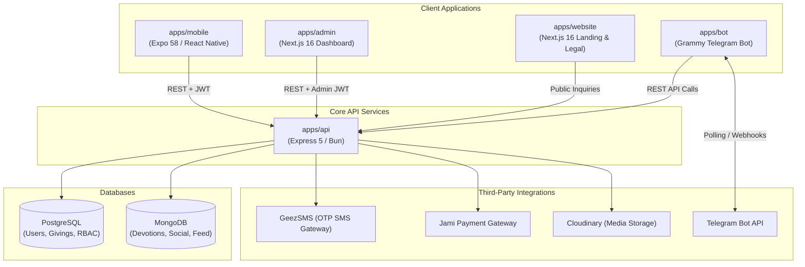

# 4 Kilo Fellowship Ecosystem (My Fellow)

[](LICENSE)
[](.github/workflows/ci.yml)
[](package.json)
[](https://bun.sh)

The official open-source digital platform for the **4 Kilo Christian Students Fellowship (AAU ECSF)**. This repository houses the entire ecosystem — cross-platform mobile client, backend REST services, administrative dashboard, public website, and Telegram automation bot — within a unified, high-performance monorepo.

---

## 1. System Architecture



---

## 2. Monorepo Applications

| Application | Path | Tech Stack | Role | Target Port / Env |
| :--- | :--- | :--- | :--- | :--- |
| **Mobile App** | [`apps/mobile`](apps/mobile) | Expo SDK 58, React Native 0.88, NativeWind, Bun | Mobile client for iOS & Android | Port 8081 / EAS |
| **REST API** | [`apps/api`](apps/api) | Node.js 24, Express 5, Prisma 7, PostgreSQL, MongoDB, Bun | Central REST backend service | Port 3000 / Render |
| **Admin Web** | [`apps/admin`](apps/admin) | Next.js 16, React 19, Tailwind CSS v4, Bun | Administrative web dashboard | Port 3000 / Vercel |
| **Public Web** | [`apps/website`](apps/website) | Next.js 16, React 19, Tailwind CSS v4, Bun | Public landing and legal portal | Port 3001 / Vercel |
| **Telegram Bot** | [`apps/bot`](apps/bot) | Grammy.js, TypeScript, Axios, Bun | Telegram automation bot | Render Worker |

---

## 3. Quickstart & Local Development

### Prerequisites
- [Bun](https://bun.sh) (v1.2+ recommended)
- [Node.js](https://nodejs.org) `>=24.3.0 <25`
- [Docker](https://www.docker.com) & Docker Compose (for local databases)

### 1. Clone & Install Dependencies
```bash
git clone https://github.com/4kilo-fellowship/my-fellow.git
cd my-fellow
bun install
```

### 2. Start Local Databases (Zero-Cost Setup)
Start local PostgreSQL and MongoDB containers with one command:
```bash
docker compose up -d
```

### 3. Initialize Database Schema
```bash
bun --filter my-fellow-api db:push
```

### 4. Run Development Servers
You can run all services via Turborepo or target individual apps:
```bash
# Run individual applications
bun run dev:api       # Starts API server on http://localhost:3000
bun run dev:mobile    # Starts Expo dev server on http://localhost:8081
bun run dev:admin     # Starts Next.js admin dashboard
bun run dev:website   # Starts public landing website
bun run dev:bot       # Starts Telegram bot
```

> **Development Mode Note:** When running locally without external SMS credentials, `apps/api` prints the 6-digit verification OTP directly to the terminal stdout for rapid testing.

---

## 4. Key Workflows & Features

- **Passwordless Ethiopian Mobile Authentication**: 6-digit OTP delivery via GeezSMS gateway with timing-safe hash verification.
- **Daily Devotionals**: Daily voice and text spiritual devotionals with offline reading fallback.
- **Giving & Financial Transparency**: Integrated local giving checkout via Jami payment gateway with automatic webhook verification.
- **Ministry Teams & Leader Directory**: Team discovery, join request submission, and fellowship leadership directory.
- **Role-Based Admin Console**: Granular user role management (`member`, `editor`, `admin`, `super_admin`).

---

## 5. Quality Assurance & Testing

All apps are verified across TypeScript type checking, linting, and automated unit test suites:
```bash
# Run full monorepo build pipeline
bun run build

# Run unit tests across all applications
bun run test

# Run code linter
bun run lint

# Run strict TypeScript type checks
bun run check-types
```

---

## 6. Documentation Directory

Detailed architectural and deployment documentation is available in [`docs/`](docs/):
- [`docs/ARCHITECTURE.md`](docs/ARCHITECTURE.md): Deep-dive architecture and subsystem interaction flows.
- [`docs/ENVIRONMENT.md`](docs/ENVIRONMENT.md): Exhaustive environment variable reference.
- [`docs/DEPLOYMENT.md`](docs/DEPLOYMENT.md): Production deployment guides for Render, EAS, and Vercel.
- [`docs/API.md`](docs/API.md): Comprehensive REST API endpoint contracts.
- [`docs/PRODUCTION_READINESS.md`](docs/PRODUCTION_READINESS.md): Production readiness verification matrix.

---

## 7. Contributing & Governance

Contributions from fellowship members and open-source developers are warmly welcome! Please see:
- [`CONTRIBUTING.md`](CONTRIBUTING.md) for contribution guidelines and branch conventions.
- [`CODE_OF_CONDUCT.md`](CODE_OF_CONDUCT.md) for community participation guidelines.
- [`SECURITY.md`](SECURITY.md) for responsible vulnerability disclosures.

---

## 8. License

This project is licensed under the [MIT License](LICENSE).
