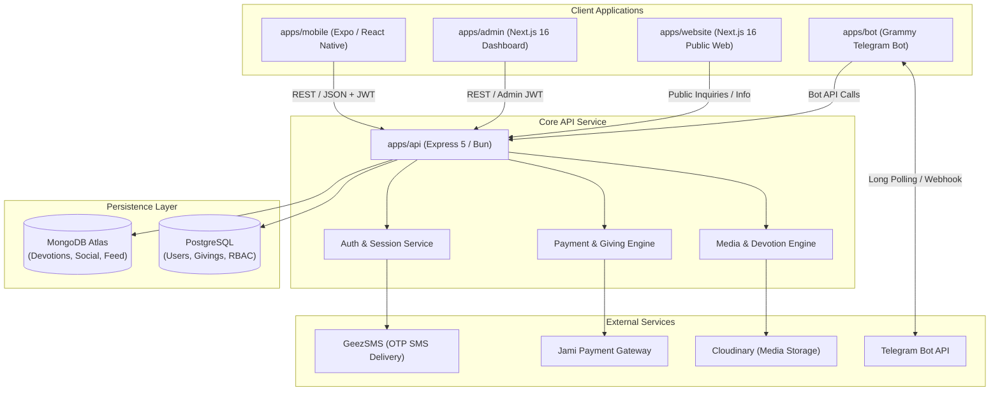
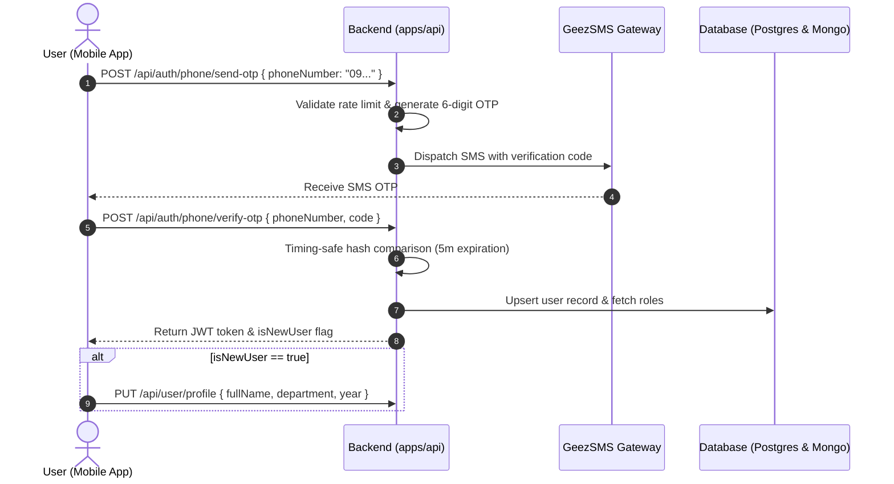

# Architecture Guide — My Fellow Ecosystem

This document describes the high-level architecture, data flows, and subsystem interactions of the **My Fellow** monorepo powering the **4 Kilo Christian Students Fellowship (AAU ECSF)**.

---

## 1. High-Level System Architecture



---

## 2. Monorepo Organization

```
my-fellow/
├── apps/
│   ├── mobile/         # Cross-platform mobile client (Expo SDK 58, React Native 0.88, NativeWind)
│   ├── api/            # Backend REST API server (Node.js 24, Express 5, Prisma 7, Bun)
│   ├── admin/          # Fellowship administrative dashboard (Next.js 16, React 19, Tailwind CSS v4)
│   ├── website/        # Public landing, information, and legal portal (Next.js 16, React 19)
│   └── bot/            # Telegram community automation bot (Grammy.js, TypeScript, Bun)
├── packages/           # Future shared libraries (contracts, utilities, validation)
├── docs/               # Architecture, environment, deployment, and API specifications
├── .github/            # GitHub Actions CI/CD workflows, issue and PR templates
├── turbo.json          # Turborepo task pipeline configuration
├── package.json        # Bun workspaces root definition
└── bun.lock            # Unified lockfile for all monorepo dependencies
```

---

## 3. Subsystem Breakdown

### 3.1 Mobile App (`apps/mobile`)
- **Runtime**: Expo SDK 58 with React Native 0.88 and NativeWind (Tailwind CSS for React Native).
- **Navigation**: Expo Router (file-system based navigation).
- **State Management**: Zustand stores for user profile, authentication, community feed, and devotions.
- **Offline Support**: Local cache fallback for daily devotionals and prayer reminders.

### 3.2 Backend REST API (`apps/api`)
- **Runtime**: Node.js 24 executed with Bun and Express 5.
- **ORM & ODM**: Dual database setup:
  - **Prisma 7 + PostgreSQL**: Relational tables for user profiles, RBAC roles, transaction logs, and financial records.
  - **Mongoose + MongoDB**: Flexible document stores for devotion contents, rich-text announcements, social feeds, and notifications.
- **Security**: Timing-safe OTP hash comparison, rate limiting, and JWT bearer tokens with auth version invalidation.

### 3.3 Admin Dashboard (`apps/admin`)
- **Framework**: Next.js 16 with App Router and React 19.
- **Role-Based Controls**: Restricted to leaders with `admin` and `super_admin` permissions.
- **Key Modules**: Member directory, devotion approvals, giving transaction ledger, fellowship department management, and location coordinate picking.

### 3.4 Public Website (`apps/website`)
- **Framework**: Next.js 16 with React 19 and Tailwind CSS v4.
- **Static Pages**: Fellowship history, mission statements, leadership structure, contact forms, legal privacy policy, terms of service, and app store account deletion workflows.

### 3.5 Telegram Bot (`apps/bot`)
- **Framework**: Grammy.js with TypeScript running on Bun.
- **Features**: Interactive menus for members to read daily devotions, register for fellowship conferences, submit prayer requests, and receive automated meeting announcements.

---

## 4. Authentication Flow


